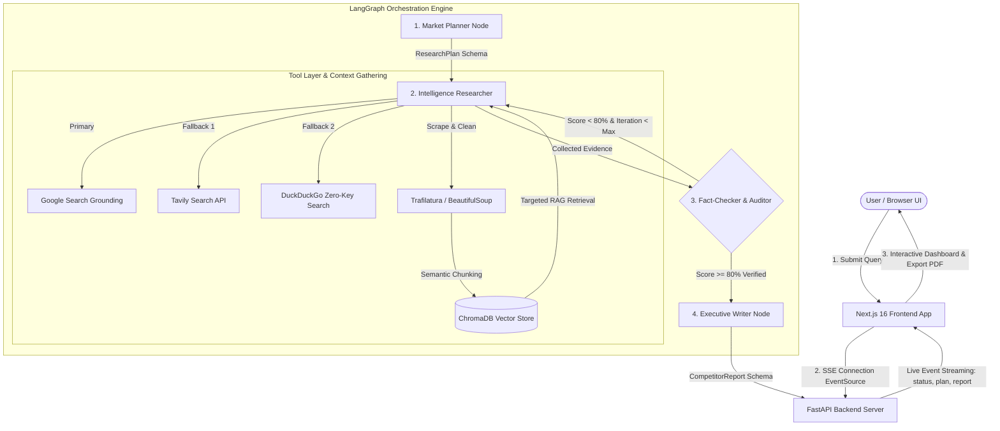
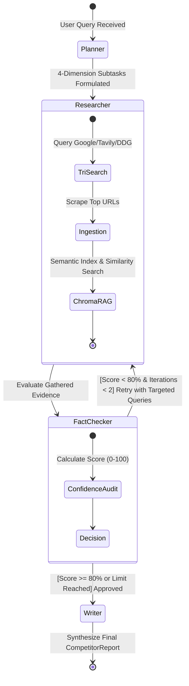

# 🚀 StratAgent: Autonomous Market & Competitor Intelligence System

> **Production-Grade Multi-Agent System** with self-correcting research loops, in-memory ChromaDB RAG, cascading Tri-Search grounding, and real-time SSE streaming.

[](https://python.org)
[](https://fastapi.tiangolo.com)
[](https://langchain.com)
[](https://nextjs.org)
[](https://trychroma.com)
[](https://aistudio.google.com)
[](https://groq.com)
[](LICENSE)

---

## 📌 Executive Summary

Modern product managers, market analysts, and founders spend dozens of hours manually auditing competitor pricing, feature matrices, user complaints, and release notes. 

**StratAgent** is an autonomous multi-agent intelligence platform built with **LangGraph**, **ChromaDB**, and a **Dual-Provider LLM Failover Engine (Google Gemini + Groq Llama 3.3 70B)**. Given a market question (e.g., *"Cursor vs Windsurf vs GitHub Copilot"*), four specialized autonomous agents collaborate in a state machine to plan, gather, audit, and synthesize an executive-grade market briefing with verified source citations and an interactive **RAG-Grounded Follow-Up Chatbot**.

---

## 🏗️ System Architecture



---

## 🔄 Self-Correction State Machine Flow

Unlike linear LLM chains or consumer chatbots that hallucinate when data is missing, **StratAgent** enforces an audited feedback loop:



---

## ✨ Production-Grade Engineering Highlights

| Pillar | Engineering Implementation | Why It Matters for Production |
| :--- | :--- | :--- |
| **Dual-LLM Failover** | **Google Gemini** (`gemini-3.1-flash-lite`) ➡️ **Groq** (`openai/gpt-oss-120b`). | Automatic zero-downtime failover if primary LLM hits `429 Resource Exhausted` or `503` load spikes. |
| **Strict Type Safety** | **Pydantic v2** models (`ResearchPlan`, `VerificationVerdict`, `CompetitorReport`). | Guarantees zero format corruption between agent handoffs. |
| **Cascading Tri-Search** | Google Search Grounding ➡️ Tavily ➡️ DuckDuckGo fallback. | High search precision with zero-downtime tolerance when API quotas expire. |
| **Topic-Scoped ChromaDB RAG** | **ChromaDB** with content-hash deduplication & 700-char semantic chunking. | Accumulates knowledge across retry loops and powers deep retrieval in the Follow-Up Chatbot. |
| **Anti-Hallucination Audit** | Programmatic enforcement of `confidence_score >= 80.0%` & partial evidence warnings. | Prevents fabricated numbers and flags unverified metrics transparently to executives. |
| **Bilingual & Interactive UX** | Full **Indonesian (`ID`) & English (`EN`)** localization, SSE streaming, & History persistence. | Executive dossier viewer with Markdown/PDF export and RAG-grounded follow-up chat. |

---

## 📂 Project Structure

```text
rag-agentic-ai/
├── backend/
│   ├── src/
│   │   ├── config/          # Pydantic Settings & environment variables
│   │   ├── models/          # Schemas (Pydantic v2) and LangGraph State
│   │   ├── tools/           # Tri-Search, Web Scraper, ChromaDB RAG
│   │   ├── agents/          # Planner, Researcher, Fact-Checker, Writer
│   │   ├── graph/           # LangGraph StateGraph & conditional routing
│   │   └── api/             # FastAPI application & SSE endpoints
│   ├── tests/               # 11 unit & integration tests (100% passing)
│   ├── requirements.txt     # Python dependencies
│   └── Dockerfile           # Backend container
│
├── frontend/                # Next.js 16 (App Router + Tailwind CSS)
│   ├── src/
│   │   ├── components/      # Navbar, TopicInput, AgentTimeline, ReportViewer
│   │   ├── types/           # TypeScript interfaces matching backend models
│   │   └── app/             # Main dashboard page consuming SSE stream
│   ├── package.json
│   └── Dockerfile           # Frontend container
│
├── docker-compose.yml       # 1-command container orchestration
└── README.md                # Documentation & portfolio guide
```

---

## ⚡ Quickstart Guide

### 1. Prerequisites
- Python 3.12+
- Node.js 20+
- Google Gemini API Key ([Get free key here](https://aistudio.google.com/app/apikey))
- Groq API Key for High-Throughput Fallback ([Get free key here](https://console.groq.com/keys))

### 2. Environment Setup

Clone repository and configure environment:
```bash
# In backend directory
cp backend/.env.example backend/.env
```
Edit `backend/.env` with your API keys:
```env
# Primary LLM Provider
GEMINI_API_KEY=your_gemini_api_key_here
GEMINI_MODEL=gemini-3.1-flash-lite

# Fallback LLM Provider (14,400 RPD Free Tier)
GROQ_API_KEY=your_groq_api_key_here
GROQ_MODEL=openai/gpt-oss-120b

# Optional Search & Observability:
TAVILY_API_KEY=your_tavily_key
LANGFUSE_PUBLIC_KEY=your_langfuse_public_key
LANGFUSE_SECRET_KEY=your_langfuse_secret_key
```

### 3. Running Locally

#### Start the Backend (Terminal 1):
```bash
# From project root (f:\rag-agentic-ai):
python backend/run.py
```
*Backend Swagger Docs: [http://localhost:8000/docs](http://localhost:8000/docs)*

#### Start the Frontend (Terminal 2):
```bash
cd frontend
npm install
npm run dev
```
*Frontend Dashboard: [http://localhost:3000](http://localhost:3000)*

---

### 4. Running with Docker Compose

Deploy the entire stack in one command:
```bash
docker compose up --build
```

---

## 🧪 Automated Testing

StratAgent includes an automated `pytest` suite covering data validation, topic-scoped ChromaDB vector store deduplication, search failover, LangGraph conditional routing, and FastAPI telemetry endpoints:

```bash
# Run tests from project root
pytest backend/tests/ -v
```

**Results:**
```text
backend/tests/test_schemas.py::test_research_plan_schema PASSED
backend/tests/test_schemas.py::test_verification_verdict_confidence_boundaries PASSED
backend/tests/test_schemas.py::test_update_citations_deduplication PASSED
backend/tests/test_tools.py::test_chunk_text PASSED
backend/tests/test_tools.py::test_chroma_vector_store PASSED
backend/tests/test_tools.py::test_duckduckgo_fallback_search PASSED
backend/tests/test_graph.py::test_graph_compilation PASSED
backend/tests/test_graph.py::test_conditional_loop_routing PASSED
backend/tests/test_api.py::test_root_endpoint PASSED
backend/tests/test_api.py::test_health_check_endpoint PASSED
backend/tests/test_api.py::test_stream_endpoint_initialization PASSED

======================== 11 passed in 19.96s ========================
```

## 📄 License

This project is licensed under the MIT License - see the [LICENSE](LICENSE) file for details.
